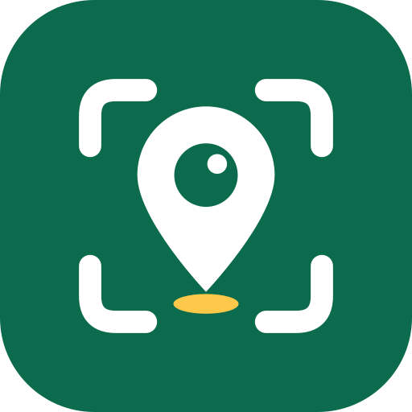

# POI Capture (Android)

An Android app for field contributors who put shops and other places on the map. Ride along a street with the phone
mounted (the app photographs the row of buildings by itself), or stop at each place and photograph it on purpose. Every
photo carries GPS, the road, the camera direction and an estimated point on the shop front; raw GNSS and the IMU are
logged so positions can be refined later. Sessions stay on the phone until uploaded (or shared as a zip) for the POI
agent, which corrects positions, reads signboards and contributes the places to the map. The zip format
(`poi-capture/3`) and the agent pipeline are in [docs/handoff.md](docs/handoff.md).

## Download

**[Latest APK](https://github.com/tewnut/poi-capture/releases/latest)** (`poi-capture-vX.Y.Z.apk`, Android 11+). Open it
on the phone and allow installing from that source. New versions install over the old one and keep the sessions.

## Flow

Two kinds of session, chosen on "Ghi mới":
- **Quét đường** (sweep): ride along a street, the app photographs the row of buildings automatically; "★ Đánh dấu"
  (or the volume keys / a Bluetooth remote on the handlebar) points out a place while riding.
- **Chụp địa điểm** (POI): stop at each place and shoot its photo kinds (configurable: ★ mặt tiền / biển hiệu / bên
  hông / bên trong / thông tin / toàn cảnh by default; the next kind is selected by itself). **Nothing to type**: the
  phone reads the text on the photos (ML Kit, Latin script incl. Vietnamese) and shows "Đọc được: name · phone ·
  category", or asks to shoot the sign again when nothing is readable; the server's agent decides name, address and
  category. "Xong địa điểm" only puts the pin on the building and, if needed, a status (đã có / đóng cửa / chuyển đi);
  optional notes stay folded. Photos are grouped by place in the export, so the agent does not have to sort them.

0. **Onboarding** (first run, about a minute): what the app does → **email** (format checked, not verified; it credits
   and groups the contributor's sessions) and an optional display name → **permissions** (camera, precise location,
   notifications, each with its reason; a shortcut to Settings when refused) → **road data**: the pack catalogue is
   fetched and the smallest region covering the contributor's position is suggested, downloaded in the background even
   on 4G → **ready**: facade distance, how to mount the phone, a summary. Everything can be changed later in **Hồ sơ**
   (which also has the server, the manual mount angle and "Xem lại phần giới thiệu").
1. **Ghi mới** (one screen): live map with GPS accuracy (and a "vị trí giả lập" note on emulators / mock locations),
   "Bạn đang ở: <road>" (recognised automatically, also while riding; works offline, names come later), **mặt tiền
   cách camera** 4 / 6 / 8 / 12 m, mode (**ảnh tự động**, **bấm tay**, **video**), then one **Bắt đầu** button.
   No vehicle and no side to choose: photo spacing (each sign on >= 2 photos) and the speed limit are computed from
   the facade distance and the camera's field of view; the side (right / left) is measured while riding.
2. **Ghi**: full-screen rear camera, locked to landscape, kept minimal. A "Sẵn sàng?" checklist (GPS, camera, road data,
   mounting) comes first; cancelling it discards the empty session. While recording, one line of plain text (GPS
   accuracy · road name; riding: the camera direction until it is measured, or a red line if it looks forward /
   backward), one warning at a time (too fast, camera cannot keep up, weak GPS, phone overheating) and "Kết thúc".
   Riding: speed against the limit, "● Đang ghi", a big "★ Đánh dấu" (also the volume keys / a Bluetooth remote).
   Places: "Chụp" and "Xong địa điểm" on the right rail, "Đọc được: …" from the sign. No map and no counters while
   shooting: the map is in "Đã ghi". Capture runs in a foreground service (camera + location), designed to keep going
   with the screen off or another app on top, and to resume after a phone call (CameraX reopens the camera; video
   continues as a new segment).
3. **Đã ghi**: "N phiên chưa gửi · km · MB" summary; each session shows date, duration, distance, count and a badge
   (Chưa gửi / Đã gửi / Đang ghi / Trống); **Gửi** (share sheet: Zalo, Drive, email…: the contributor picks where it
   goes), **Bản đồ** (track, a dot per photo, the estimated shop-front point; tap a dot to see the photo, **Sửa vị trí**
   by tapping the right place or dragging the dot, **Về vị trí GPS** to undo), and "Lưu file zip" / "Xoá" in the ⋮ menu. Sessions cut off by a crash or dead
   battery show "bị gián đoạn" and still send.

Safety: the phone is mounted; the app never needs a tap while riding in auto mode.

## Getting the data to VMAP

- **Background upload** (in the code, not in the UI since 0.9: sending is "Gửi" to the app the contributor picks;
  a team server can be provisioned again later): with an upload URL set, every finished session is uploaded
  automatically over Wi-Fi (or 4G if allowed) with the tus resumable protocol: a lost connection resumes from where the
  server stopped, the zip is built once and verified by SHA-256. "Đã ghi" shows Chờ Wi-Fi / Đang tải x% / Đã tải lên /
  Cần tải lại (edited after upload) / Lỗi, and, with the optional API, what the agent found. Server contract:
  [docs/server-api.md](docs/server-api.md).
- **Without a server**: "Gửi" shares the zip (Zalo, Drive, email…) or saves it, as before.
- **Offline road data** (Hồ sơ → Dữ liệu đường offline): road packs per region built from OpenStreetMap (Geofabrik)
  by [tools/roadpack](tools/roadpack/README.md) and published monthly as the GitHub release `roadpacks`; downloaded
  over Wi-Fi (or right away during onboarding) from that catalogue or another URL, or imported from a file.
  The road is then recognised without network; elsewhere the app asks Overpass and keeps the answer on the phone.
- **Already recorded** ("đã quét"): "Ghi mới" draws the phone's own sessions in green and, with the server API, the
  team's in purple, so contributors go where nothing is recorded yet.
- **Privacy**: photos leave the phone unblurred (faces, licence plates); the server / agent must blur before anything
  is published (`manifest.privacy`, handoff.md step 0).

## Build and run

Needs JDK 17–21 (not 25: Gradle 8.14 does not run on it) and the Android SDK (platform 36). On this machine:

```
# PowerShell
$env:JAVA_HOME = "$env:USERPROFILE\.jdks\jbr-21.0.11"
.\gradlew.bat :app:testDebugUnitTest      # JVM tests of the core logic
.\gradlew.bat :app:assembleDebug          # app\build\outputs\apk\debug\app-debug.apk
.\gradlew.bat :app:installDebug           # onto a connected phone / emulator
```

Or open the folder in Android Studio and set Gradle JDK to a 17/21 JDK. Requires Android 11+ (minSdk 30).

## Release

Bump `versionCode` / `versionName` in `app/build.gradle.kts`, commit, then push a matching tag:

```
git tag v0.8.0
git push origin main v0.8.0
```

[.github/workflows/release.yml](.github/workflows/release.yml) runs the unit tests, builds the release APK, signs it
with the release key from the repository secrets (`RELEASE_KEYSTORE_B64`, `RELEASE_KEYSTORE_PASSWORD`,
`RELEASE_KEY_ALIAS`), checks the signature and attaches `poi-capture-vX.Y.Z.apk` (+ `.sha256`) to the release. Keep the
keystore backed up outside the repository: an APK signed with another key cannot update the installed app. A local
signed build works the same way with `RELEASE_KEYSTORE_FILE` set to the keystore path.

## Status

Verified on the build machine: the APK builds without warnings and all JVM unit tests of `core/` pass (geodesy, side
model and U-turn, warnings, auto-shot spacing, Overpass parsing, crash-safe storage, zip/manifest format).

Not yet verified on a real phone: the foreground service with camera + location types (strict on Android 14+), CameraX
photos and segmented MP4, capture with the screen off, camera recovery after a call (check that video does not pile up
empty segments while the camera is closed), raw GNSS / IMU logging, share and save of the zip, osmdroid tiles and
Overpass. The raw GNSS log follows GnssLogger's "Raw" column names, but its column order has not been checked against
GnssLogger output.

Not built yet (next phase): on-device sign detection, OCR, position filtering (EKF) and RTK, see the research notes.

## Settings

Defaults live in `core/Session.kt` (`Settings`) and are stored per device in SharedPreferences: tile URL (swap OSM for
VMAP tiles), Overpass URL, photo spacing, speed limits, GPS accuracy limit, photo size, JPEG quality, video segment
length, mount offset. Only the mount offset has a field in the UI so far.

## Code

| File | What |
|---|---|
| `core/Geo.kt` | distance, bearing, nearest point on a line, side model, camera bearing with mount offset |
| `core/Road.kt` | OSM ways, heading-aware road matching, grid cells for auto road loading, Overpass queries |
| `core/FixProcessor.kt` | per-fix logic: travel bearing/speed, travel direction, U-turn, warnings, item metadata, auto-shot spacing |
| `core/Session.kt` | session model, settings, schema id |
| `core/SessionStore.kt` | per-session folders, append-only files (crash-safe) |
| `core/Exporter.kt` | streaming zip: manifest.json, track.geojson, gnss_raw.csv, imu.csv, photos, videos |
| `capture/CaptureService.kt` | foreground service: CameraX photos / segmented video, GPS, camera model, session control |
| `capture/Recorders.kt` | raw GNSS logger (full tracking), IMU logger and shake snapshot |
| `core/TrackStats.kt` | distance / duration of a ride, main roads of a session |
| `core/CapturePlan.kt` | photo spacing and speed limit from the facade distance and field of view |
| `core/MountEstimator.kt` | camera direction relative to travel from acceleration / braking (no compass) |
| `core/Poi.kt` | session kinds (sweep / POI), photo roles, place records |
| `core/Upload.kt` | tus client and the resumable upload job (zip once, SHA-256, resume, re-upload after edits) |
| `core/Coverage.kt` | thinned tracks / places for the "đã quét" map, team coverage GeoJSON |
| `capture/Uploads.kt` | WorkManager upload worker, server read API (status, coverage) |
| `ui/PoiSheet.kt` | "Xong địa điểm": pin on the building, what was read, status, folded notes |
| `core/SignText.kt`, `capture/SignOcr.kt` | on-device sign reading: ML Kit OCR, then phone / house number / category / name rules |
| `core/PhotoRoles.kt`, `ui/PhotoRolesCard.kt` | photo kinds of POI mode as config (default, Hồ sơ, team server) |
| `net/OverpassClient.kt` | Overpass HTTP with mirror fallback, shared cache (setup screen warms what the service needs) |
| `MainActivity.kt` | app shell: edge-to-edge, bottom navigation (Ghi mới / Đã ghi / Hồ sơ), first run → onboarding |
| `ui/OnboardingScreen.kt`, `core/Onboarding.kt` | first-run flow; email check, display name, pack suggestion |
| `ui/RoadPacksCard.kt`, `capture/RoadPackWork.kt`, `core/RoadPack.kt` | offline road packs: catalogue, download, lookup |
| `ui/SetupScreen.kt` | live map + GPS status, road mode, side pictures, mode, Start |
| `ui/CaptureScreen.kt` | camera preview, HUD, get-ready checklist |
| `ui/SessionMap.kt` | session map: track, photo dots, photo panel, position correction (tap or drag) |
| `ui/SessionsScreen.kt`, `ui/ProfileScreen.kt`, `ui/Components.kt` | sessions list, profile, shared pills / side sketch / live location |
| `app/src/test/…` | JVM unit tests for everything in `core/` |

`core/` has no Android dependencies, so the on-device pipeline that comes next (sign detection, OCR, POI positioning)
can be built and tested on top of it the same way.

## License

Code: [Apache License 2.0](LICENSE) (see [NOTICE](NOTICE)). Offline road packs contain OpenStreetMap data,
© OpenStreetMap contributors, [ODbL 1.0](https://www.openstreetmap.org/copyright).
